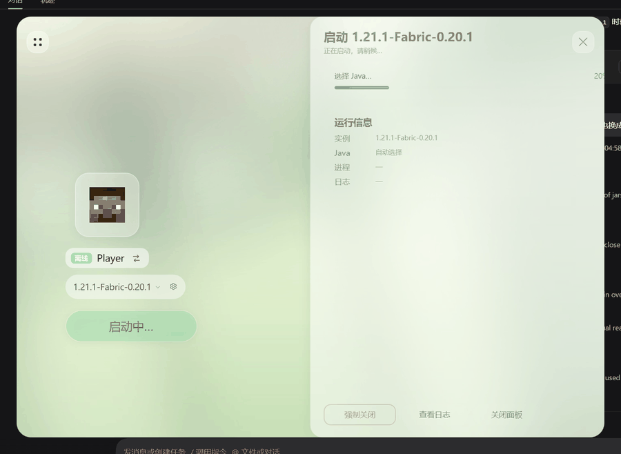
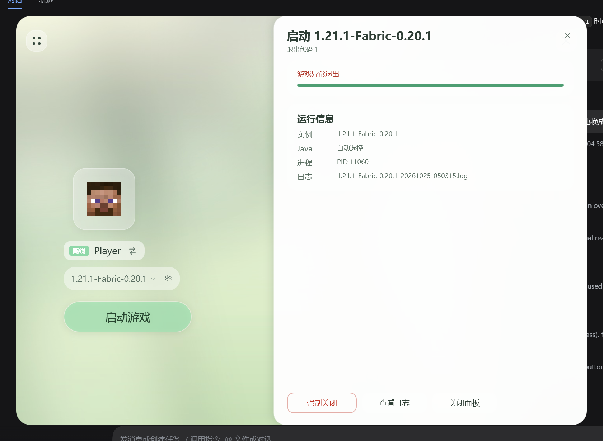
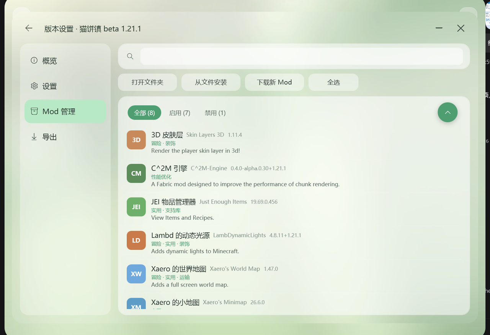
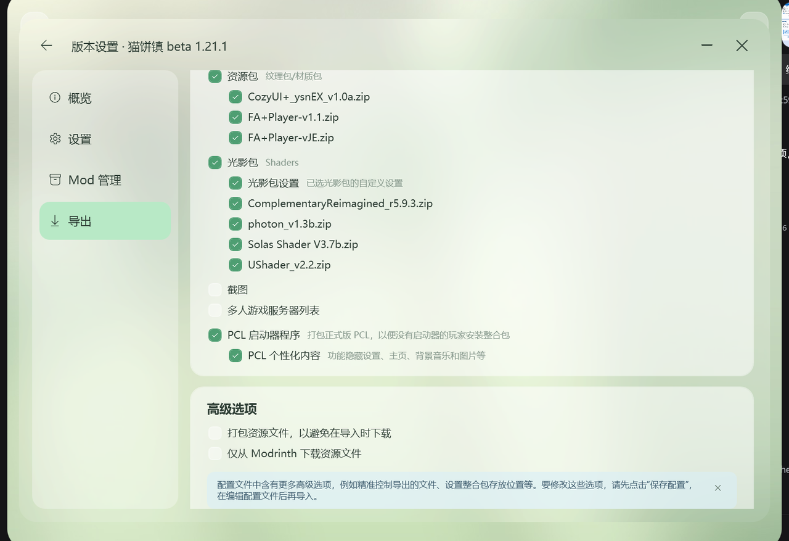

# Mutsumi Launcher

[](https://github.com/mouchang/MTL)
[](https://github.com/mouchang/MTL/releases/latest)
[](https://github.com/mouchang/MTL/actions/workflows/build.yml)
[](LICENSE)
[](https://dotnet.microsoft.com/)
[](#)

**MTL** · 面向 Minecraft Java 版的 Windows 桌面启动器。WPF + .NET 10，**零第三方 NuGet 依赖**。

> 当前版本：**MTL alpha v1.0.2 build 1**（`1.0.2`） · [下载安装包](https://github.com/mouchang/MTL/releases/latest)


## 这一版（v1.0.2）

- **下载链路重做**：直连 / 代理自动兜底、源失败分级、域名冷却、本地文件复用、全局限速
- **自建 Cloudflare 镜像**：官方 CDN 直连不通时自动走 `mtl.dpdns.org`（墙外回源 + 边缘缓存）
- **移除 MCIM 文件源**：它只是个 302 跳转器，会给半截文件和错文件名，社区文件只走 官方 CDN → 自建镜像
- **社区资源合并展示**：同一个 Mod 只有一张卡片，顶部 Modrinth / CurseForge 标签就地切换来源
- **中文搜索**：内置常见 Mod 中英别名，「工业」「植物魔法」直接搜
- **OptiFine 安装**：原版 → OptiFine 一键合并成独立实例

逐条记录见 [CHANGELOG.md](CHANGELOG.md)。

## 功能

### 安装
- 原版 / Fabric / Forge / NeoForge / **OptiFine**，可选任意游戏版本
- 下载源自动选择（官方 / BMCLAPI 测速）+ 手动切换；**版本清单**与**文件下载**分开设置
- 依赖库走双镜像路径（`bmclapi/maven` + `bmclapi/libraries`），Forge / Fabric / NeoForge 的 maven 同样纳入镜像
- **PCL2 式下载引擎**：全局线程池、HTTP Range 多段并发、源失败切换、流式 SHA-1 校验、低速断开换源
- **本地文件复用**：装新实例时直接复制本机已有的客户端 jar / 依赖 / Mod，不重复下载
- **下载限速**：不限速 / 1 MB/s / 4 MB/s / 10 MB/s，所有下载线程共用一份额度

### 启动
- 自动探测本机 Java；没有合适的运行时自动下载 Adoptium JRE
- 每个实例可单独设置 Java、内存、版本隔离
- 启动面板：进度、实例、Java、PID、实时日志、**强制关闭**
- 游戏异常退出时自动分析日志并给出可读原因
- 启动前清理 Fabric remap 残留，使用独立临时目录

### 社区与 Mod
- **聚合搜索**：并行搜索 Modrinth 与 CurseForge，同一资源合成一张卡片，来源标签就地切换
- **中文搜索**：中文关键词自动翻译成英文再搜，结果栏提示实际使用的搜索词（可在数据目录放 `search-aliases.json` 扩充）
- 详情页 / 版本列表 / 前置依赖 / 安装共用同一套模型，两个平台无差别
- Mod 管理：启用 / 禁用 / 删除 / 从文件安装 / 检查更新（Modrinth SHA-1 与 CurseForge 指纹反查）
- 资源包、光影包、数据包安装

### 外观
- **主题**：明亮 / 暗色 / 自定义（浅色或深色底 + 主色），点一下即时生效
- 设置页左侧分类（基础 / 启动 / 下载 / 其他），不用一路往下滚

### 数据与账号
- 离线账号、微软正版登录（等待 Mojang 应用审核）
- 整合包导入（Modrinth `.mrpack` / CurseForge / MMC · Prism）与导出（`.mrpack` / `.zip`）
- **存档管理**：世界列表（名称 / 版本 / 最后游玩 / 体积）+ 一键备份与还原
- 实时监听 `versions/`，安装或删除版本后界面自动刷新
- 内置日志查看器与文件夹浏览器，不依赖系统资源管理器

### 发布与网络
- 自包含发布 + NSIS 单文件安装器（内置 VC++ 运行库，兼容精简版 Windows）
- 自动更新：GitHub Releases + Cloudflare Worker 代理，失败直连回退
- **直连 / 代理自动兜底**：一条路失败自动换另一条；国内镜像（BMCLAPI / 自建镜像）始终优先直连
- 镜像配置与自建 Worker 见 [worker/README.md](worker/README.md)

## 界面

| 启动页 | 下载页 |
| --- | --- |
|  |  |

### 启动面板

点击「启动游戏」后从右侧滑出，显示进度、进程与日志，并支持强制关闭：





### 社区资源

同一个资源只有一张卡片，点 Modrinth / CurseForge 标签就地切换来源：


### 版本设置

| Mod 管理 | 导出实例 |
| --- | --- |
|  |  |

## 技术栈

| 项 | 选择 |
| --- | --- |
| 运行时 | .NET 10（`net10.0-windows`，LTS） |
| UI | WPF，无边框圆角窗口 + 自绘标题栏、玻璃拟态控件 |
| 第三方依赖 | **零**（优先官方 API / 自绘控件） |
| 架构 | 视图 + 轻量 ViewModel；页面级 UserControl 切换 |
| 安装包 | NSIS（自包含，约 42 MB，附 VC++ 运行库） |
| 镜像 | Cloudflare Worker（`worker/`，反代 + 边缘缓存） |

## 运行与构建

需要 .NET 10 SDK 与 Windows 10/11：

```powershell
# 运行
dotnet run --project src/MutsumiLauncher

# 编译
dotnet build -c Release

# 自包含发布
dotnet publish src/MutsumiLauncher/MutsumiLauncher.csproj `
  -c Release -r win-x64 --self-contained true -p:Version=1.0.2 -o dist/publish
```

调试时可用环境变量直达某个页面：

```powershell
$env:MTL_START_PAGE = "download"   # launch / download / settings
```

打安装包、发版流程见 [docs/packaging.md](docs/packaging.md)。

## 目录

```text
MutsumiLauncher/
├─ src/MutsumiLauncher/          # 启动器主程序
│  ├─ Themes/                   # 调色板、控件样式
│  ├─ Views/                    # MainWindow、页面、版本设置、浮层
│  ├─ ViewModels/               # 列表项与卡片模型
│  ├─ Services/                 # 安装、启动、下载、资源、更新、账号等核心逻辑
│  ├─ Assets/                   # 背景、头像、图标
│  └─ app.manifest              # PerMonitorV2 DPI + 管理员权限
├─ installer/MutsumiLauncher.nsi # NSIS 安装脚本
├─ worker/                       # Cloudflare Worker（更新代理 / 镜像 / NeoForge 反代）
├─ docs/                         # 文档与界面截图
├─ .github/workflows/            # Build / Release 自动构建
└─ MutsumiLauncher.slnx
```

## 文档

| 文档 | 说明 |
| --- | --- |
| [CHANGELOG.md](CHANGELOG.md) | 版本更新记录 |
| [CONTRIBUTING.md](CONTRIBUTING.md) | 环境、代码风格、提交规范 |
| [SECURITY.md](SECURITY.md) | 安全问题报告方式 |
| [docs/packaging.md](docs/packaging.md) | 发布与打包流程 |
| [worker/README.md](worker/README.md) | Cloudflare Worker 部署与镜像配置 |

## 路线图

- [x] 原版 / Fabric / Forge / NeoForge / OptiFine 安装与合并实例
- [x] 启动面板、崩溃原因、Java 自动下载
- [x] Modrinth + CurseForge 聚合搜索、合并卡片、中文搜索
- [x] Mod 管理、更新检查、资源包 / 光影 / 数据包
- [x] 下载任务（进度 / 速度 / 取消 / 重试 / 限速 / 本地复用）
- [x] 整合包导入导出
- [x] 自动更新（Worker 代理 + 直连回退）
- [x] NSIS 单文件安装器
- [ ] 微软登录（等待 Mojang 应用审核）
- [ ] CurseForge 官方 API（等待审核）
- [ ] 聚合结果「只显示一条」去重模式

## 许可

[MIT](LICENSE) © 2026 mouchang。MTL 为独立项目，与任何现有启动器无隶属关系。
