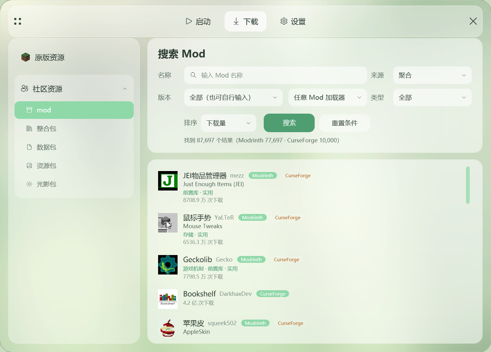
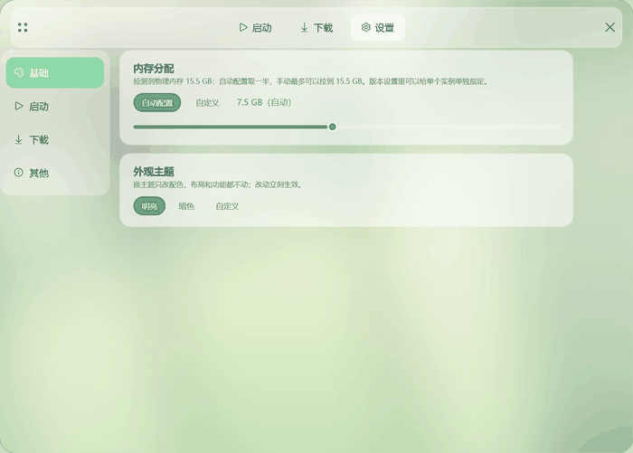
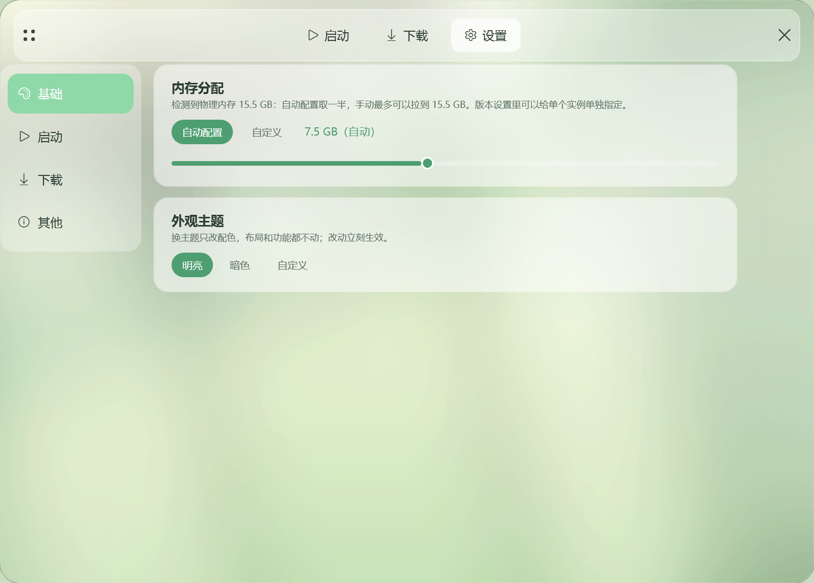
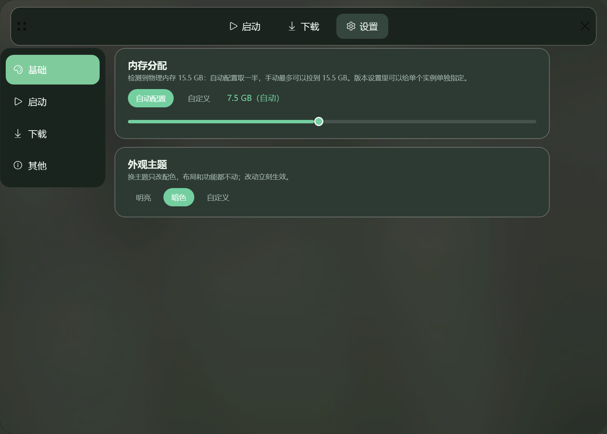
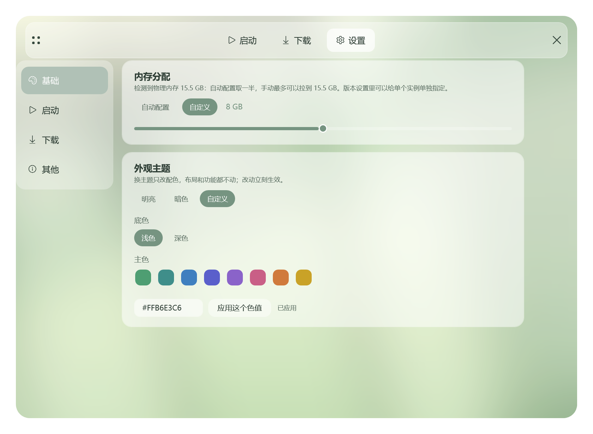

# Mutsumi Launcher

[](https://github.com/mouchang/MTL)
[](https://github.com/mouchang/MTL/releases/latest)
[](https://github.com/mouchang/MTL/actions/workflows/build.yml)
[](LICENSE)
[](https://dotnet.microsoft.com/)
[](#)

**MTL** 是一个面向 Minecraft Java 版的 Windows 启动器：WPF + .NET 10，**零第三方 NuGet 依赖**。

装版本、找 Mod、管存档、改主题，都在一个窗口里完成。

> 当前版本：**MTL Release v1.0.0 build 1** · [下载最新版](https://github.com/mouchang/MTL/releases/latest)


## 下载

| 形式 | 说明 |
| --- | --- |
| **安装版** `MutsumiLauncher-1.0.0-Setup.exe` | NSIS 单文件安装器，自带 VC++ 运行库，写注册表 / 开始菜单 / 卸载项 |
| **便携版** `MutsumiLauncher-1.0.0-portable.zip` | 解压即用，游戏数据写在程序目录下的 `game\\` |

两者都是**自包含发布**，目标机器不需要安装 .NET 运行时。启动器与安装器都需要管理员权限。

## 界面



| 启动 | 安装版本 | Mod 管理 |
| --- | --- | --- |
|  |  |  |

### 主题



| 明亮（默认） | 暗色 | 自定义 |
| --- | --- | --- |
|  |  |  |

## 功能

### 安装

- 原版 / **Fabric / Forge / NeoForge / OptiFine**，加载器与基版本自动合并成独立实例
- 版本清单与文件下载可分别指定来源（官方 / BMCLAPI），也可以让程序自己测速择优
- 下载引擎：全局线程池、HTTP Range 多段并发、失败换源、流式 SHA-1 校验、低速自动切换
- 装新实例时复用本机已有的 jar / 依赖 / Mod；下载限速、安装并发上限都在设置里

### 启动

- 自动探测本机 Java，缺合适的运行时自动下载 Adoptium JRE
- 每个实例可单独指定 Java、内存与版本隔离；全局内存支持「自动（物理内存的一半）」或自定义
- 离线 / 微软正版账号；正版可免密续期，头像与皮肤自动缓存

### 社区资源

- **Modrinth 与 CurseForge 聚合搜索**：一次搜索同时查两边，同名资源合并成一张卡片，
  卡片顶部切换来源；两边的结果交替排列，翻页时两边都有
- 支持 Mod / 整合包 / 数据包 / 资源包 / 光影包，可按游戏版本、加载器、类型、排序筛选
- 详情页直接看简介、画廊、版本列表，一键下载并安装到指定实例
- 接入两个自建的反向代理，国内不挂梯子也能正常搜索和下载

### Mod 管理

- 列表显示名称、版本、启用状态，支持启用 / 禁用 / 删除、按文件名搜索
- **检查更新**：按文件指纹或 Modrinth 版本比对，自动跳过「已经是最新」的情况，
  兼容性不匹配的版本不会被推荐
- 从文件安装、打开 Mod 文件夹、全部更新一键完成

### 存档

- 读取 `level.dat` 显示存档名、游戏版本和最后游玩时间
- 一键打包备份，按时间点还原，备份文件可单独拷走

### 其它

- **内置代理**：随安装包分发 mihomo 内核，可切换节点、测速、自检；不需要时随时关闭
- 三个主题：明亮 / 暗色 / 自定义（8 个预设主色，也能填 `#RRGGBB`，深浅底可选）
- 整合包导出为 `.mrpack` 或普通压缩包，也能导入别人分享的整合包
- 下载任务在独立的浮窗里排队，支持暂停 / 继续 / 取消

## 系统要求

| 项目 | 要求 |
| --- | --- |
| 系统 | Windows 10 1809 及以上（64 位） |
| 运行时 | 无需预装，安装包自带 |
| 权限 | 首次运行需要管理员权限（写安装目录、结束游戏进程） |
| 磁盘 | 安装版约 70 MB，游戏文件另算 |

## 常见问题

**杀软报毒？** 没有签名证书，NSIS 安装包偶尔会被误报，加白名单即可。

**搜索很慢 / 拿不到结果？** 先确认网络能直连，再在「设置 → 下载 → 内置代理」里点一次测试；
两项都正常还慢的话，多半是上游接口在抽风。

**换了代理之后要重启吗？** 不用。程序会在每次请求时重新判断走直连还是走代理。

**数据存哪？** 全部在安装目录里：游戏文件在 `game\\`，配置、缓存和日志在 `data\\`，
不再往 C 盘的 AppData 写东西。设置页「其他」里能查看路径、改到别的盘。

## 从源码构建

需要 .NET 10 SDK：

```bash
dotnet build MutsumiLauncher.slnx -c Release
dotnet run --project src/MutsumiLauncher
```

打包（NSIS 3.11+，内核 zip 放 `tools/core/mihomo.zip`）见 [docs/packaging.md](docs/packaging.md)。

## 反馈

- 问题与建议：[Issues](https://github.com/mouchang/MTL/issues)
- 更新记录：[CHANGELOG.md](CHANGELOG.md)
- 参与开发：[CONTRIBUTING.md](CONTRIBUTING.md)

## 许可

[MIT](LICENSE)