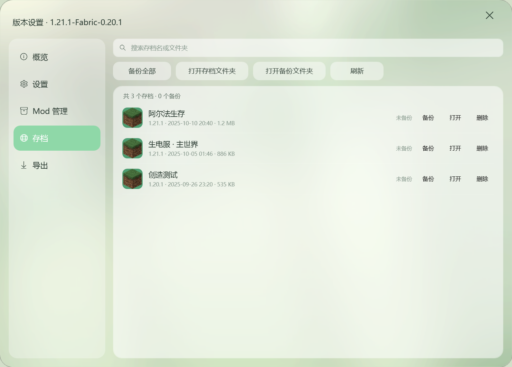
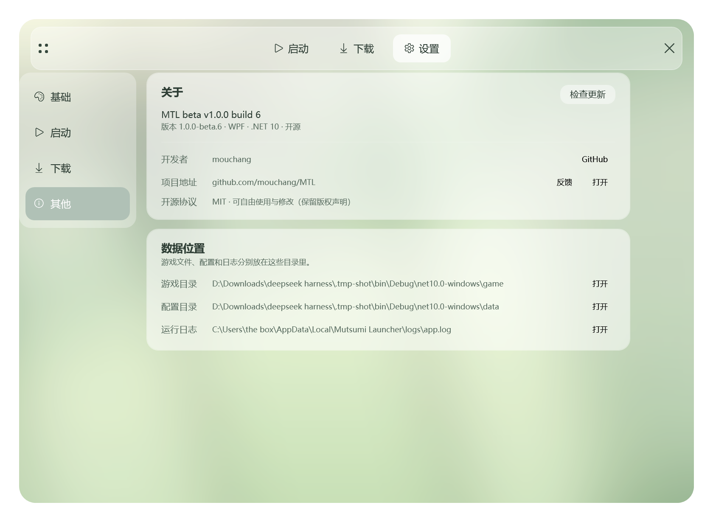

# Mutsumi Launcher

[](https://github.com/mouchang/MTL)
[](https://github.com/mouchang/MTL/releases/latest)
[](https://github.com/mouchang/MTL/actions/workflows/build.yml)
[](LICENSE)
[](https://dotnet.microsoft.com/)
[](#)

**MTL** 是一个面向 Minecraft Java 版的 Windows 启动器：WPF + .NET 10，**零第三方 NuGet 依赖**。

装版本、下 Mod、管存档、改主题，都在一个窗口里完成。

> 当前版本：**MTL beta v1.0.0 build 2**（`1.0.0-beta`） · [下载安装包](https://github.com/mouchang/MTL/releases/latest)


## 下载

| 形式 | 说明 |
| --- | --- |
| **安装版** `MutsumiLauncher-1.0.0-beta-Setup.exe` | NSIS 单文件安装器，自带 VC++ 运行库，写注册表 / 开始菜单 / 卸载项 |
| **便携版** `MutsumiLauncher-1.0.0-beta-portable.zip` | 解压即用，数据写在程序目录下的 `game\\` |

两者都是**自包含发布**，目标机器不需要装 .NET 运行时。启动器与安装器都需要管理员权限。

## 这一版做了什么

这是一次界面和体验上的大改版：

- **主题**：明亮 / 暗色 / 自定义三套配色，切换即时生效。自定义可以选浅色或深色底，主色有 8 个预设，也能直接填 `#RRGGBB`，标题色、提示底色、按钮色都由主色自动派生。深色主题换用了一张压暗过的底图，不是给亮图蒙一层黑。
- **设置页重做**：从一长条卡片改成左侧分类——基础 / 启动 / 下载 / 其他，常用项一眼能找到。
- **存档管理**：版本设置里新增「存档」页，直接读出 `level.dat` 里的存档名、游戏版本和最后游玩时间，一键打包备份、按时间点还原。
- **分类标签全中文**：整合包、光影、资源包的类型下拉补齐了翻译，加载器（`fabric` / `iris` / `optifine` …）和类型标记（`minecraft` / `datapack` …）不再混进分类里占位置。

逐条记录见 [CHANGELOG.md](CHANGELOG.md)。

## 主题


| 明亮（默认） | 暗色 | 自定义 |
| --- | --- | --- |
|  |  |  |

## 功能

### 安装

- 原版 / **Fabric / Forge / NeoForge / OptiFine**，可选任意游戏版本，加载器与基版本自动合并成独立实例
- 下载源自动测速择优（官方 / BMCLAPI）或手动指定；**版本清单**与**文件下载**分开设置
- 下载引擎：全局线程池、HTTP Range 多段并发、源失败切换、流式 SHA-1 校验、低速自动换源
- 本机已有文件复用：装新实例时直接复用官方启动器与本启动器里同名的 jar / 依赖 / Mod
- 全局限速：不限 / 1 / 4 / 10 MB·s⁻¹，所有下载线程共用一份额度
- 安装并发上限 2，第三个自动排队，排队状态在任务面板可见

### 启动

- 自动探测本机 Java，没有合适的运行时自动下载 Adoptium JRE
- 每个实例可单独指定 Java、内存与版本隔离；全局内存支持「自动（按物理内存一半）」或自定义
- 启动面板：进度、实例、Java、PID、实时日志、强制关闭
- 游戏异常退出时自动分析日志，给出可读原因

### 社区与整合包

- **聚合搜索**：并行搜 Modrinth 与 CurseForge，同一资源只出现一张卡片，顶部来源标签就地切换
- **中文搜索**：内置 MC百科 14,119 条离线译名表，不联网
- 分类标签中文显示，支持按平台分类、游戏版本、加载器筛选
- Mod 管理：启用 / 禁用 / 删除 / 从文件安装 / 检查更新（SHA-1 与 CurseForge 指纹反查）
- 资源包、光影包、数据包安装
- 整合包导入（Modrinth `.mrpack` / CurseForge / MMC·Prism）与导出

### 存档

- 世界列表：存档名、游戏版本、最后游玩时间、占用空间、世界图标，可按名字搜索
- **备份**：整个世界打包成 zip，按世界分目录存放，单个或「备份全部」
- **还原**：先解压到临时目录再整体换过去，中途失败原存档不受影响
- 备份记录里可以按时间点还原、删除旧备份

### 账号

- 离线账号与微软正版登录
- 保存 refresh token，启动前自动续期；登录后自动拉取正版皮肤头像

### 网络

- 每条请求在直连与代理之间自动兜底，连不上的域名进入冷却
- 可选内置 mihomo 内核：按需启停，订阅从 Cloudflare 取，节点凭据不落盘
- 自建 Cloudflare Worker 镜像（`worker/`）：官方 CDN 直连不通时回源 + 边缘缓存

### 发布

- 自包含发布 + NSIS 单文件安装器，GitHub Actions 打 `v*` tag 自动出包
- 自动更新：GitHub Releases + Worker 代理，失败回退直连

## 界面

| 下载页 | 社区资源 |
| --- | --- |
|  |  |

| 版本设置 | 存档管理 |
| --- | --- |
|  |  |

| Mod 管理 | 关于 |
| --- | --- |
|  |  |

## 技术栈

| 项 | 选择 |
| --- | --- |
| 运行时 | .NET 10（`net10.0-windows`） |
| UI | WPF，无边框圆角窗口 + 自绘标题栏 + 玻璃拟态控件 |
| 第三方依赖 | **零**（优先官方接口 / 自绘控件） |
| 主题 | 语义色板 + `DynamicResource`，运行时整份替换 |
| 安装包 | NSIS，约 42 MB，内置 VC++ 运行库 |
| 镜像 | Cloudflare Worker（`worker/`） |

## 开发

需要 .NET 10 SDK 与 Windows 10/11。

```powershell
# 运行
dotnet run --project src/MutsumiLauncher

# 编译
dotnet build -c Release

# 自包含发布
dotnet publish src/MutsumiLauncher/MutsumiLauncher.csproj `
  -c Release -r win-x64 --self-contained true `
  -p:Version=1.0.0-beta -o dist/publish
```

调试时可以直达某个页面 / 分类：

```powershell
$env:MTL_START_PAGE       = "launch"    # launch / download / settings
$env:MTL_SETTINGS_TAB     = "basic"     # basic / launch / download / about
$env:MTL_OPEN_SETTINGS    = "1"         # 直接打开版本设置浮层
$env:MTL_VERSION_TAB      = "saves"     # overview / launch / mods / saves / export
$env:MTL_GAME_DIR         = "D:\\mc"      # 指定游戏目录
```

打安装包与发版流程见 [docs/packaging.md](docs/packaging.md)。

## 目录

```text
MutsumiLauncher/
├─ src/MutsumiLauncher/
│  ├─ Themes/          # 色板、字体、控件样式
│  ├─ Views/           # 主窗口、页面、版本设置、浮层
│  ├─ ViewModels/      # 列表项与卡片模型
│  ├─ Services/        # 安装、启动、下载、资源、账号、主题、存档…
│  └─ Assets/          # 背景、图标、MC百科译名表
├─ installer/          # NSIS 安装脚本
├─ worker/             # Cloudflare Worker（更新代理 / 镜像 / NeoForge 反代）
├─ tools/              # 离线数据生成脚本（译名表、深色底图）
├─ docs/               # 文档与界面截图
└─ .github/workflows/  # Build / Release
```

## 文档

| 文档 | 说明 |
| --- | --- |
| [CHANGELOG.md](CHANGELOG.md) | 版本更新记录 |
| [CONTRIBUTING.md](CONTRIBUTING.md) | 环境、代码风格、提交规范 |
| [SECURITY.md](SECURITY.md) | 安全问题报告方式 |
| [docs/packaging.md](docs/packaging.md) | 发布与打包流程 |
| [worker/README.md](worker/README.md) | Cloudflare Worker 部署与镜像配置 |

## 路线图

- [x] 原版 / Fabric / Forge / NeoForge / OptiFine 安装与合并实例
- [x] 下载引擎、任务面板、限速、本地复用
- [x] Modrinth + CurseForge 聚合搜索、中文搜索、Mod 管理
- [x] 整合包导入导出、资源包 / 光影 / 数据包安装
- [x] 微软正版登录
- [x] 明亮 / 暗色 / 自定义主题
- [x] 存档备份与还原
- [ ] 微软登录等待 Mojang 应用复核
- [ ] CurseForge 官方 API
- [ ] 聚合结果「只显示一条」去重模式

## 许可

[MIT](LICENSE) © 2026 [mouchang](https://github.com/mouchang)

MTL 是独立项目，与任何现有启动器无隶属关系。
