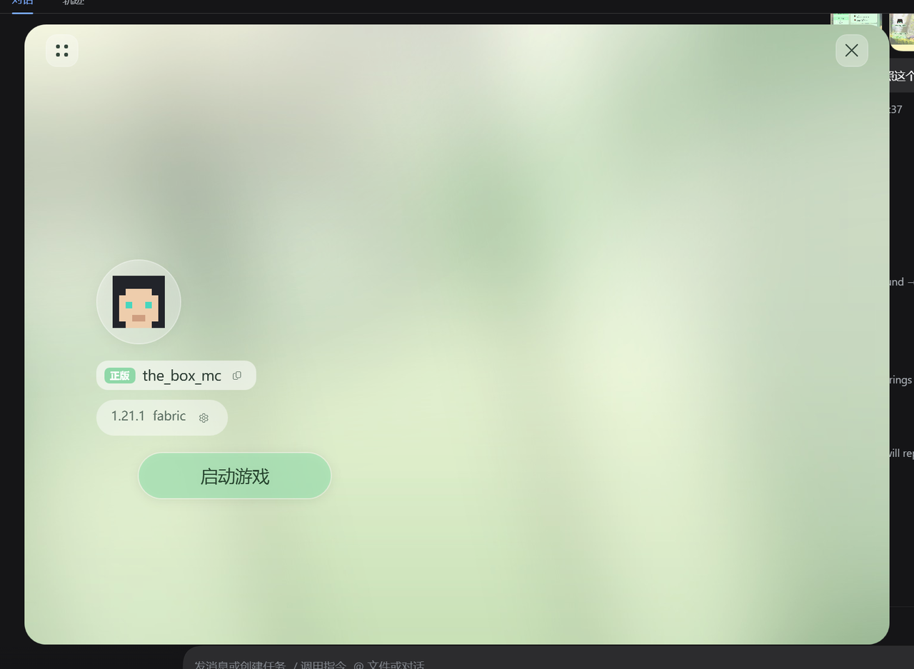
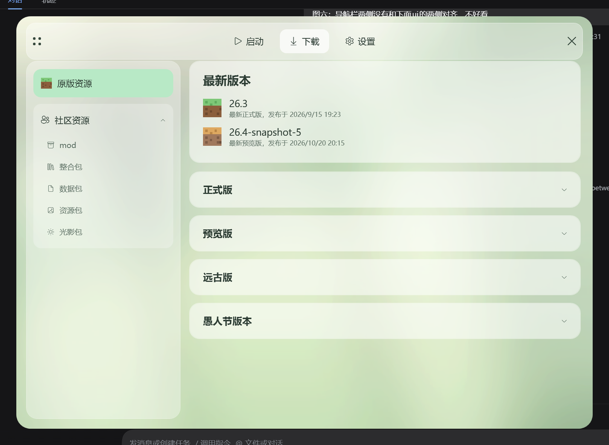
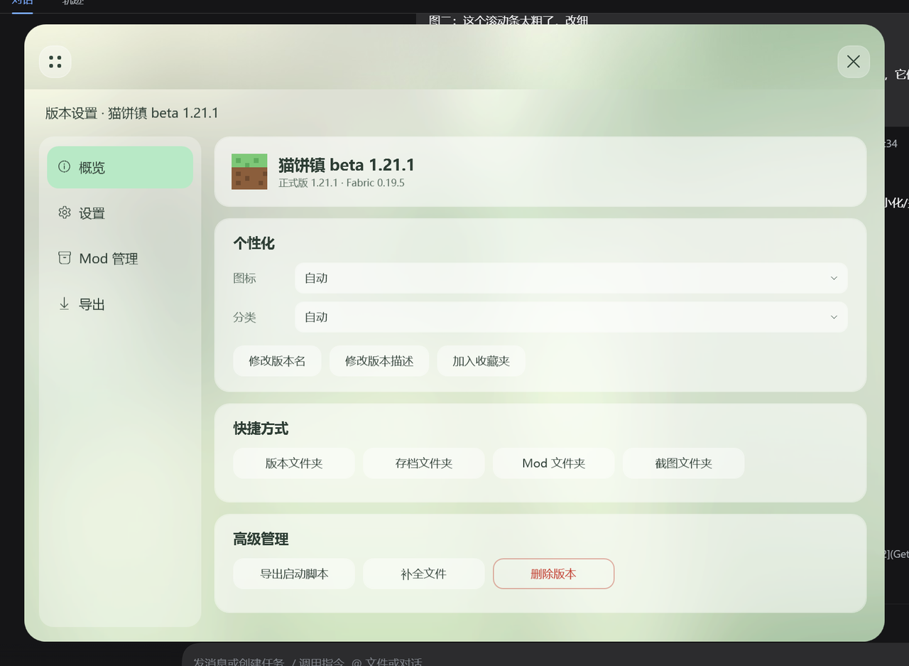
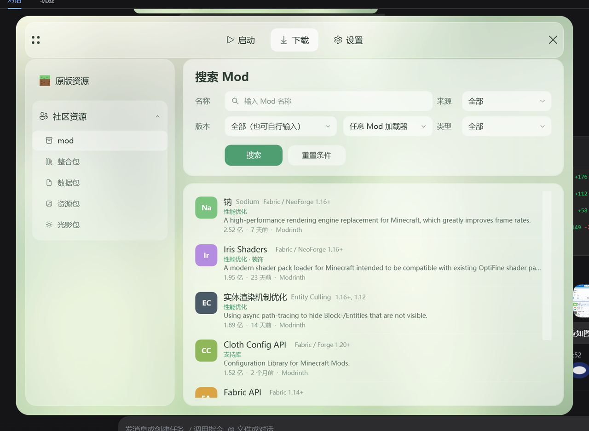
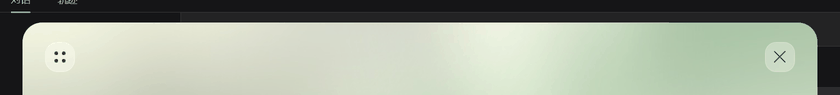

# Mutsumi Launcher

[](https://github.com/mouchang/MTL)
[](LICENSE)
[](https://dotnet.microsoft.com/)
[](#)

**MTL** · 一个面向 Minecraft 的桌面启动器（WPF / .NET 10）。

> 当前进度：`0.1.0`。已完成：真实版本清单、Java 探测、版本下载安装（含 assets）、启动游戏、离线账号、微软正版登录（需 Azure 应用先通过 Mojang 的应用审核）。





## 技术栈

| 项 | 选择 |
| --- | --- |
| 运行时 | .NET 10（`net10.0-windows`，LTS） |
| UI | WPF，无边框圆角窗口 + 自绘标题栏 |
| 第三方依赖 | **零**（后续按需引入，优先官方包） |
| 架构 | 视图 + 轻量 ViewModel；页面级 UserControl 切换 |

## 运行

```powershell
# 直接跑
dotnet run --project src/MutsumiLauncher

# 只编译
dotnet build

# 发布单文件（后续接入发布流程）
dotnet publish src/MutsumiLauncher -c Release -r win-x64 --self-contained true -p:PublishSingleFile=true
```

调试时可用环境变量直达某个页面：

```powershell
$env:MTL_START_PAGE = "download"   # launch / download / settings
```

## 目录

```text
MutsumiLauncher/
├─ src/MutsumiLauncher/
│  ├─ Themes/          # 调色板、控件样式（按钮/标签页/卡片/手风琴）
│  ├─ Views/           # MainWindow + Pages（Launch / Download / Settings）
│  ├─ ViewModels/      # 下载页的版本数据（占位）
│  ├─ Services/        # 日志
│  ├─ Assets/          # 背景、头像、图标
│  └─ app.manifest     # PerMonitorV2 DPI
├─ docs/screenshots/   # 界面截图
└─ MutsumiLauncher.slnx
```

## 界面

- **窗口**：1120×820（自动适配工作区 92%），26px 圆角，阴影，拖动标题栏移动，支持高 DPI。
- **启动页**：头像、正版标识、用户名（可复制）、版本胶囊、启动按钮；背景为整幅插画。
- **下载页**：左侧来源列表（原版资源 / 社区资源及其子类），右侧「最新版本」卡片 + 四个可折叠版本分组，切换页面时背景自动高斯模糊。
- **设置页**：外观、下载源、Java、数据目录占位项。
- **汉堡菜单**：点击左上角按钮，导航条会从按钮本身的形状向右生长成整条玻璃导航层（启动 / 下载 / 设置），右侧关闭按钮的底片同步溶解、与导航条融为一条；启动页上点击层外自动收起，子页上常驻；页面切换带淡入动画；底部有轻提示（Toast）。
- **版本设置浮层**：启动页版本胶囊右侧的齿轮打开，在同一窗口内从底部滑出并覆盖整窗（含标题栏，主界面按钮同步溶解）；浮层自带关闭按钮，关闭时向下滑回；左侧「概览 / 设置 / Mod 管理 / 导出」四页，玻璃卡片 + 自绘下拉框 / 勾选框 / 单选按钮 / 滑杆。
  - 概览：版本信息、个性化、快捷方式、高级管理（导出启动脚本 / 补全文件 / 删除版本）
  - 设置：启动选项、内存分配（滑杆 + 内存占用条）、服务器、高级选项折叠区、全局设置入口
  - Mod 管理：名称搜索、启用状态过滤、回到顶部悬浮按钮
  - 导出：可勾选的导出内容树（Mod / 资源包 / 光影包 / 启动器程序等）、高级选项与配置读写入口
- **社区资源搜索**：下载页切到 mod / 整合包 / 数据包 / 资源包 / 光影包 后，右侧变为对应分类的搜索页（独立标题、搜索占位与结果数据）；Mod 页多一个「任意 Mod 加载器」下拉，整合包页多一个「安装已有整合包」按钮；「原版资源」仍显示版本清单。

### 通用 UI 组件

- **搜索框**：放大镜图标 + 占位文字 + 一键清空按钮，Mod 管理与社区搜索共用同一控件。
- **加载遮罩**：半透明蒙层 + 旋转弧线 + 文案，搜索/加载时覆盖内容区。
- **消息对话框**：玻璃风确认框，支持 Esc 取消 / Enter 确定；「删除版本」等危险操作走它确认。
- **提示气泡 / 细滚动条**：全局替换系统默认 ToolTip 与 ScrollBar 样式。








## 已接入真实数据

- **下载浮标**：开始下载后离开下载页，右下角会出现浮标（显示进行中数量与总进度）；点击打开「下载任务」面板，列出每个任务的速度、进度、状态，支持多任务并存。
- **下载源设置**：设置页新增「下载源」子界面（右侧滑入），可分别为「原版资源」和「社区资源」选择官方源或镜像源；同页可设置**网络代理**（直接连接 / 跟随系统 / 自定义），默认直连——系统代理关掉后不会再导致所有请求失败。选择即时保存，代理模式重启后生效。
- **原版版本列表**：正式版 / 预览版 / 远古版 / 愚人节版本不再限量，清单里有多少显示多少。
- **社区搜索分页**：Modrinth 搜索结果按 20 条一页，列表底部显示「第 x / y 页 · 共 N 个结果」与页码按钮（上一页 / 页码 / 下一页）。
- **下载加速**：原版资源默认走 BMCLAPI（版本清单 / 版本 JSON / client / libraries / assets），社区资源默认走 MCIM（Modrinth API、CDN 文件与图标）；可在 `config.json` 用 `VanillaMirror` / `ModMirror` 设为 `official` 切回官方。
- **版本清单**：启动时从 `piston-meta.mojang.com` 拉取 `version_manifest_v2.json`，按类型拆成正式版 / 预览版 / 远古版 / 愚人节版本，并高亮最新正式版与预览版；数据缓存到本地（6 小时内直接读缓存），网络失败时回退缓存，再失败则显示内置示例并在卡片上提示。右侧「刷新」可强制重新拉取。

- **加载器安装**：原版版本详情页的加载器行点击后展开该游戏版本可用的**全部** Fabric Loader 版本（不限稳定版），选中高亮；Fabric / Forge / NeoForge 互斥，选中一个后其余行禁用并显示「与所选加载器不互通」，底部按钮固定为「开始下载」统一安装。
- **下载详情页**：原版版本列表和社区搜索结果都改为「点条目打开详情」，详情从右侧滑入（280ms）。原版详情展示版本信息、加载器（Forge / NeoForge / Fabric / OptiFine）与「开始下载」；Modrinth 详情展示项目图标、信息（下载量 / 分类 / 更新时间）、**全部受支持游戏版本**的标签（两行、横向滚动、带下方导航条、不限数量）、带加载器徽标的文件列表与逐个安装，另有「转到 Modrinth」「复制名称」。项目图标会下载到本地 `icons/` 缓存；版本来源目前是 Modrinth，CurseForge 客户端已留好骨架（配置 `CurseForgeApiKey` / `MTL_CURSEFORGE_KEY` 后即可并入）。
- **图标**：图标下载到本地 `icons/` 缓存并校验图片头，镜像失败时自动回退官方 CDN；原版条目使用官方材质渲染（正式版=草方块、远古版=泥土、预览版=命令方块、愚人节=金块），社区条目使用项目真实图标（本地缓存，失败回退首字母），详情页文件行带加载器徽标。
- **社区资源（Modrinth）**：搜索走 Modrinth 开放 API，版本下拉直接读取 `/v2/tag/game_version` 的正式版本，支持按游戏版本、加载器、类型筛选；从搜索页进入详情时会把当前选择的版本带过去并自动选中对应标签；详情页内按文件安装，按项目类型落到 `mods` / `resourcepacks` / `shaderpacks` / `datapacks`（开启版本隔离时装进 `versions/<版本>/`），文件带 SHA-1 校验。整合包目前下载 `.mrpack`，自动安装待做。Personal Access Token 可选：环境变量 `MTL_MODRINTH_TOKEN` 优先，其次本地 `config.json` 的 `ModrinthToken`（不会入库）。
- **Java 探测**：启动器扫描 `JAVA_HOME`、`PATH`、注册表（JavaSoft）、常见安装目录（Adoptium / Microsoft / Zulu / Corretto 等）以及 `.minecraft
untime`，优先读 JDK 自带 `release` 文件解析版本，失败再跑 `java -version`；结果去重后按主版本倒序展示。设置页可查看与重新检测，版本设置里的 Java 下拉直接使用这份列表。

- **版本安装**：下载页每个版本行都有「安装」，确认后依次拉取版本 JSON、client jar、依赖库（含 Windows natives），逐文件做 SHA-1 校验，落盘到游戏目录；顶部有进度条。

- **启动游戏**：启动页「启动游戏」会挑选已安装版本启动——解压 natives、拼 classpath、按 `minecraftArguments` / `arguments.game` 替换占位符、用离线 UUID，并按版本要求自动选 Java（1.16 及更早 → 8、1.17 → 16、1.18–1.20.4 → 17、1.20.5+ → 21）；游戏输出写入 `游戏目录\logs\<版本>-<时间>.log`。实测可启动 Beta 1.8.1。

- **资源文件**：安装与启动前都会检查 `assets/indexes/<id>.json`，按索引下载缺失的 objects（按哈希寻址、跳过已存在文件、12 并发），进度实时显示。
- **界面细节**：所有滚动条（含横向导航条）统一为胶囊形主题绿滑块，默认 8px，鼠标悬停放大 1.45 倍、拖动时放大 1.9 倍，松手回弹（120ms 动画）；侧栏选中项与「全部」标签同色高亮；启动页头像外框是比头像大两圈的圆角方形。
- **缓存管理**：设置页显示缓存大小与路径（版本清单缓存 + 项目图标缓存），一键清理并提示释放大小。
- **配置持久化**：玩家名、所选版本、Java 路径、内存分配、版本隔离写入 `config.json`；点击启动页的版本胶囊会从底部滑出「选择启动版本」浮层（带滑入/滑出动画），选中即记住；版本设置里的 Java / 内存 / 隔离改动即时保存并参与启动。

- **账号**：启动页头像旁的账号胶囊显示当前账号与类型（离线/正版），点 ⇄ 从底部滑出账号浮层，可添加离线账号（校验 3–16 位字母数字下划线）、切换、删除；账号列表与选择写入 `config.json`，启动时使用当前账号的名字与离线 UUID（`OfflinePlayer:<name>` 的 MD5）。

- **微软登录**：账号浮层里的「正版登录」弹出带淡入/上滑动画的窗口，显示设备码与验证链接，并**自动复制设备码、自动打开浏览器**；两处都有「复制」按钮兜底。授权后依次换取 Xbox Live / XSTS / Minecraft accessToken，拉取档案与皮肤；需要先在 `config.json` 填 `MicrosoftClientId`（或设置环境变量 `MTL_MS_CLIENT_ID`）。
- **皮肤头像**：微软账号下载皮肤 PNG，裁 8×8 正脸并叠加帽子层（64×64 皮肤），按最近邻放大显示；离线账号使用 `Assets/steve-head.png`（取自 Unoclix 的原版史蒂夫皮肤）。启动时微软账号使用 `accessToken` + `userType=msa`。

## 素材替换

界面用的是占位素材，可以直接替换同名文件：

| 文件 | 用途 | 建议 |
| --- | --- | --- |
| `src/MutsumiLauncher/Assets/background.jpg` | 窗口背景 | 横图，≥ 1920×1280，浅色系 |
| `src/MutsumiLauncher/Assets/avatar.png` | 玩家头像 | 8×8 像素图，会按最近邻放大 |
| `src/MutsumiLauncher/Assets/app.ico` | 应用与任务栏图标 | 多尺寸 ico（16/32/48/256） |

> 视觉效果以 `docs/screenshots/` 中的截图为准；占位背景只是临时氛围图。

## 路线图

- [x] 仓库初始化与工程骨架
- [x] 三页界面与导航（启动 / 下载 / 设置）
- [x] 版本清单拉取（Mojang piston-meta，带本地缓存与失败回退）
- [x] Java 探测（JAVA_HOME / PATH / 注册表 / 安装目录 / Minecraft 运行时，解析版本号）
- [x] 版本安装（版本 JSON、client jar、libraries，SHA-1 校验，进度条）
- [x] 启动游戏（natives 解压、classpath、参数替换、按版本自动选 Java、进程与日志）
- [x] 资源文件（assets 索引 + objects，断点续传、并发下载）
- [x] 启动页版本切换与配置持久化（`config.json`）
- [x] 离线账号管理（添加 / 切换 / 删除，离线 UUID）
- [x] 微软正版登录（设备码 OAuth → Xbox Live → XSTS → Minecraft 服务，需自备 clientId）
- [x] 皮肤头像（微软账号拉皮肤裁正脸，离线默认史蒂夫）
- [x] Modrinth 搜索与安装（mod / 资源包 / 光影 / 数据包）
- [ ] 整合包 `.mrpack` 自动解析安装
- [ ] 游戏启动与进程管理
- [ ] 资源下载、校验与断点续传
- [ ] 实例（版本隔离）管理

## 许可

待定（尚未添加 `LICENSE`）。MTL 为独立项目，与任何现有启动器无隶属关系。
