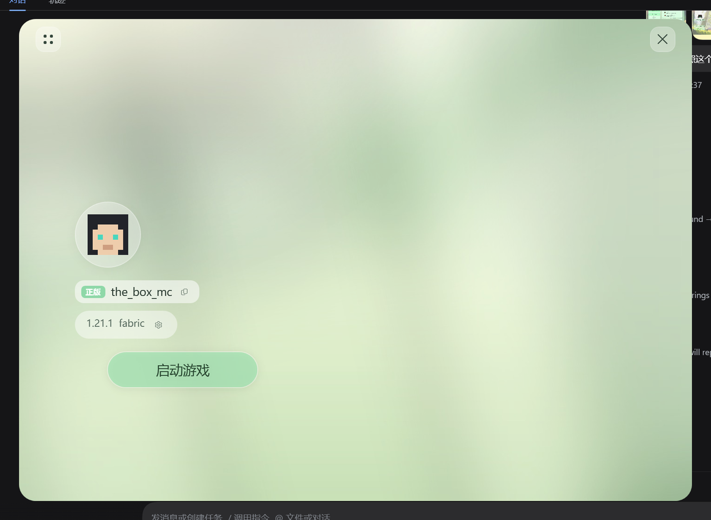

# Mutsumi Launcher

[](https://github.com/mouchang/MTL/releases/latest)
[](https://github.com/mouchang/MTL/actions/workflows/build.yml)
[](LICENSE)
[](https://dotnet.microsoft.com/)
[](#)

**MTL** 是一个面向 Minecraft Java 版的 Windows 启动器：WPF + .NET 10，**零第三方 NuGet 依赖**。

安装游戏、管理实例与 Mod、导入导出整合包、备份存档、切换主题，都在一个窗口里完成。

> [下载最新版本](https://github.com/mouchang/MTL/releases/latest) · [更新日志](CHANGELOG.md) · [问题反馈](https://github.com/mouchang/MTL/issues)



## 下载

| 形式 | 说明 |
| --- | --- |
| **安装版** `MutsumiLauncher-*-Setup.exe` | NSIS 单文件安装器，自带 VC++ 运行库，创建开始菜单快捷方式与卸载项 |
| **便携版** `MutsumiLauncher-*-portable.zip` | 解压即用，所有数据都留在程序目录里 |

两者都是**自包含发布**，目标机器无需安装 .NET 运行时。启动器与安装器都需要管理员权限。

## 功能

### 安装与启动

- 支持原版 / **Fabric / Forge / NeoForge / OptiFine**，加载器与基版本合并成独立实例
- 版本清单与文件下载来源可分别选择（官方 / BMCLAPI），也可以让程序测速择优
- 自动探测本机 Java；每个实例可单独指定 Java 与内存，全局内存支持「自动」或自定义
- 离线账号与微软正版账号；正版令牌可免密续期，头像与皮肤自动缓存

### 实例管理

- 安装、重命名、删除实例；版本列表显示游戏版本与加载器
- **引用**其它启动器的 `.minecraft`：不复制文件，用影子实例把 mods / 存档 / 配置指回原处
- **导入**其它启动器的 `.minecraft`：选择版本复制进来，可只补缺失的 libraries / assets
- 启动前自动补齐缺失依赖，Forge 安装器走国内镜像

### 社区资源

- **Modrinth 与 CurseForge 聚合搜索**：一次搜索同时查两边，同名资源合并，卡片顶部切换来源
- 支持 Mod / 整合包 / 数据包 / 资源包 / 光影包，可按游戏版本、加载器、类型、排序筛选
- 详情页展示简介、画廊与版本列表，一键下载并安装到指定实例
- 前置依赖折叠成胶囊标签，只显示必需项
- 下载文件名自动加上中文名前缀（如 `[钠] sodium-fabric-….jar`）

### 整合包

- 支持 `.mrpack` / CurseForge / MMC 格式，导入后自动装好基版本与加载器
- 文件并发下载，缺失文件自动重试；安装完成后删除安装包本体
- 可导出为 `.mrpack` 或普通压缩包

### Mod 管理

- 显示真实 Mod 名与图标（优先中文名，图标优先读 jar 自带图片）
- 启用 / 禁用 / 删除、按名称搜索
- **检查更新**：按文件指纹与版本比对，只推荐兼容当前游戏版本与加载器的版本
- 检查完成后可一键筛选「可更新」，支持单个更新与全部更新

### 存档

- 读取 `level.dat` 显示存档名、游戏版本与最后游玩时间
- 一键打包备份，按时间点还原，备份文件可单独拷走

### 界面

- 三个主题：明亮 / 暗色 / 自定义（8 个预设主色，也能填任意 `#RRGGBB`）
- 列表虚拟化，几百个 Mod 也能流畅滚动
- 下载任务面板显示进度、速度与剩余任务，可取消与重试

## 网络

启动器**不内置任何代理**，下载走系统代理：

- 系统 / 本机代理可用时自动使用（Clash、v2ray 等常见端口都能识别）
- 原版资源优先走 BMCLAPI 镜像，Modrinth / CurseForge 的接口走自建反代
- 也可以在「设置 → 下载」里手动指定代理地址与端口

## 数据存放位置

全部数据都在安装目录（或便携版所在目录）内，不写系统盘的用户目录：

```
<安装目录>\
  ├ data\            配置、账号、缓存、图标、日志
  ├ game\
  │   ├ .minecraft\  versions / libraries / assets
  │   ├ modpacks\    整合包下载与导出
  │   └ temp\        安装器临时文件
  └ data-root.txt     可选：数据目录被改到别处时记录指针
```

数据目录与游戏目录都可以在「设置 → 其他」里改到别的盘，支持连同现有数据一起迁移。

## 从源码构建

需要 .NET 10 SDK 与 Windows。

```bash
dotnet publish src/MutsumiLauncher/MutsumiLauncher.csproj -c Release -r win-x64 \
  --self-contained true -o dist/publish

# 可选：打安装包（需要 NSIS 3.x）
makensis installer/MutsumiLauncher.nsi
```

仓库结构：

```
src/MutsumiLauncher/   启动器主体（WPF）
installer/             NSIS 安装脚本
tools/                 辅助工具（MC百科数据抓取等）
worker/                反向代理 Worker 的源码
docs/                  截图与文档
```

## 常见问题

**启动报「缺少依赖文件」？**
启动器会在启动前自动补齐缺失的 libraries；如果仍然失败，日志里会写明缺哪个文件。

**引用的实例改了原目录还在吗？**
引用模式不移动任何文件，mods / 存档 / 配置都留在原 `.minecraft` 里；
「断开引用」只会删除启动器这边的影子实例。

**卸载会删掉我的存档吗？**
不会。卸载前会先断开所有引用实例，再删除安装目录，不会顺着目录联接到外部游戏目录。

**游戏启动后又立刻退出？**
看「启动」面板里的实时日志，或者 `game\.minecraft\versions\<实例>\crash-reports\` 下的报告。

## 反馈

- Bug 与功能建议请走 [Issues](https://github.com/mouchang/MTL/issues)
- 提交代码前请先看 [CONTRIBUTING.md](CONTRIBUTING.md)

## 许可证

[MIT](LICENSE)

## 致谢

- [PCL2](https://github.com/Meloong-Git/PCL)：下载引擎的分源与重试策略、MC百科条目匹配思路
- [OpenBMCLAPI](https://github.com/bangbang93/openbmclapi)：原版游戏文件的国内镜像
- [MCIM](https://mcimirror.top)：CurseForge 接口的社区镜像
- [MC百科](https://www.mcmod.cn)：Mod 中文名与缩写数据

## 赞助

- 爱发电主页：https://afdian.com/a/box_star
